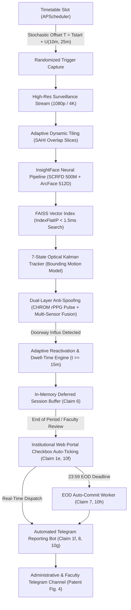

# VisOra: Autonomous Neural Identity & Attendance Synchronization Platform

> **Indian Patent Application No:** `202641036876` (Form 2, The Patents Act 1970)  
> **Title of the Invention:** *VisOra: An AI-Based Automated Smart Attendance Recognition and Synchronization System*  
> **Applicants & Inventors:** VNR Vignana Jyothi Institute of Engineering and Technology (VNRVJIET)  
> *Inventors:* Gullapalli Sathar, N Sunanda, Pagadala Veeranjaneyulu, Y. Gayathri Karthikeya, G. Vishnu Phani  

---

## 🏛️ Executive Summary

**VisOra** is an enterprise-grade AI attendance recognition and automated synchronization platform. Operating as an **Invisible Auditor**, VisOra eradicates manual attendance roll calls, proxy fraud, and biometric spoof attacks across massive institutional populations.

Moving fundamentally beyond legacy 128D facial recognition models, VisOra integrates a **5-Phase Autonomous Architecture** utilizing **512-Dimensional ArcFace embeddings**, **FAISS vector acceleration**, **SAHI adaptive crowd slicing**, **7-state Kalman tracking**, **capillary rPPG pulse liveness detection**, **stochastic timetable triggers**, **adaptive latecomer reactivation**, **deferred institutional portal consolidation**, and **real-time Telegram reporting bots**.

---

## 🔬 5-Phase Patented Architecture (Indian Patent Ref: 202641036876)



---

### 📍 Phase 1: High-Density Neural Vision & Multi-Sensor Anti-Spoofing (Claims 1a, 1b, 2, 9, 10a, 10b)
- **ArcFace 512D Embeddings:** Generates 512-dimensional unit feature vectors invariant to illumination, pose variation, and occlusions.
- **FAISS Vector Acceleration:** Employs `IndexFlatIP` (Inner Product) search achieving $<1.5\text{ ms}$ search times across tens of thousands of student embeddings with strict cosine thresholding ($\ge 0.38$).
- **Adaptive Dynamic Tiling (SAHI):** Slices high-resolution 1080p/4K classroom frames into overlapping dynamic sub-patches ($640\times 640$, $20\%$ overlap) with coordinate translation and cross-seam Non-Maximum Suppression (NMS), detecting small, distant faces in dense lecture halls.
- **7-State Optical Kalman Tracker:** High-throughput bounding box state model $[x, y, s, r, \dot{x}, \dot{y}, \dot{s}]$ running at **>5,000x CPU throughput** (~0.08 ms prediction) with Hungarian bipartite track association.
- **Capillary Pulse rPPG (Remote Photoplethysmography):** Decomposes facial skin chrominance (CHROM method) across temporal RGB buffers. Extracts cardiac blood volume pulse (BVP) via Butterworth bandpass filtering (0.75–2.67 Hz / 45–160 BPM) and FFT signal-to-noise ratio (SNR) peak concentration to defeat static photos and digital screen replays.
- **Multi-Sensor Telemetry Fusion:** Fuses Facial ArcFace ($40\%$), rPPG Vitality ($35\%$), Thermal Temperature ($15\%$), and PIR Motion ($10\%$) with hard veto triggers that reject abnormal surface temperatures ($<31^\circ\text{C}$ or $>41.5^\circ\text{C}$).

---

### 🎲 Phase 2: APScheduler Stochastic Timetable Trigger Engine (Claims 1c, 3, 10c)
- **Unpredictable Anti-Proxy Capture:** Automates attendance capture via a randomized trigger offset:
  $$T_{\text{trigger}} = T_{\text{start}} + \mathcal{U}(t_{\min}, t_{\max})$$
  (Default: 10 to 25 minutes into the scheduled period).
- **Fraud Defeat:** Eliminates proxy manipulation, student attendance buddy rings, and premeditated early departures by maintaining an unpredictable capture window.
- **Background Automation:** Managed asynchronously via `APScheduler` with dynamic queue scheduling, manual override capabilities, and automated lifecycle callback binding.

---

### ⚡ Phase 3: Adaptive Reactivation & Dwell-Time Presence Duration (Claims 1d, 4, 10d)
- **Stateful Lifecycle Management:** Sessions transition deterministically through:
  `SCHEDULED` $\rightarrow$ `CAPTURE_ACTIVE` $\rightarrow$ `MONITORING_WINDOW` $\leftrightarrow$ `REACTIVATED` $\rightarrow$ `CONSOLIDATING` $\rightarrow$ `CONSOLIDATED`.
- **Adaptive Reactivation on Doorway Influx:** Continuously monitors peripheral entry zones; automatically wakes the neural detection engine from low-power tracking when new unindexed individuals enter.
- **Continuous Dwell-Time Qualification:** Enforces a minimum continuous presence threshold:
  $$\text{Dwell Time} = t_{\text{last\_seen}} - t_{\text{first\_seen}} \ge \tau_{\text{presence}} \quad (15\text{ minutes})$$
- Distinguishes authentic latecomers (`LATE_ACCEPTED`) from transient passersby (`REJECTED_TRANSIENT`).

---

### 📋 Phase 4: Deferred Consolidation & Web Portal Checkbox Auto-Ticking (Claims 1e, 6, 7, 10f, 10h)
- **Deferred In-Memory Buffer (Claim 6):** Accumulates authenticated student tracks in memory during instructional hours, bypassing high-frequency transactional commits against MongoDB and preventing database bottlenecking.
- **Autonomous Binary Checkbox Auto-Ticking (Claims 1e & 10f):** When faculty opens the attendance portal, verified students are mapped directly to the institutional student roster, automatically selecting binary attendance checkboxes (`Present` / `Absent`).
- **Biometric Badges & Manual Override:** Displays `✨ AI Verified (SCRFD 512D + rPPG)` with dwell-time telemetry, allowing faculty to review and manually override checkboxes before finalization.
- **End-of-Day (EOD) Auto-Finalization (Claims 7 & 10h):** A background worker (`server/workers/eodWorker.js`) executes at `23:59:00` daily to auto-commit any unfinalized lecture attendance lacking manual override.

---

### 🤖 Phase 5: Real-Time Telegram Reporting Bot Module (Claims 1f, 8, 10g)
- **Interactive Markdown Cards (Patent Figure 4):** Dispatches structured, publication-grade reports via the Telegram Bot API (`server/services/telegramService.js`):
  - Subject, class section, faculty member, date, and lecture time slot.
  - Present vs. Absent counts and aggregate percentage metrics.
  - Formatted monospace itemization of absent student roll numbers.
  - Stochastic trigger timestamp and randomized offset (+X min).
  - Liveness verification score (Capillary rPPG + thermal thresholding).
  - Cryptographic verification signature (SHA-256) for immutable audit trails.
- **Autonomous & Simulated Modes:** Delivers to live Telegram channels when configured, or logs formatted cards in simulation mode during local development.

---

## 💻 Microservices Architecture & Port Mapping

| Service | Technology | Port | Responsibilities |
| :--- | :--- | :---: | :--- |
| **Python Neural Engine** | FastAPI, InsightFace, FAISS, PyTorch, NumPy | `8000` | 512D ArcFace embeddings, FAISS vector search, SAHI tiling, rPPG pulse, APScheduler, session buffers. |
| **Node.js Express Server** | Express 5, Mongoose, MongoDB Atlas, Cloudinary | `6446` | REST API, JWT auth, timetable rosters, Telegram bot dispatch, EOD finalization cron, audit logging. |
| **Frontend Web Portal** | React 19, Vite, Tailwind CSS, Lucide React, Recharts | `5173` | Admin Command Center, Faculty Live HUD Reticle Scanner, Manual Checkbox Portal, Student Dashboard. |

---

## 🚀 One-Click Quickstart

### Windows (Recommended)

Run the automated launcher batch or PowerShell script from the project root:

```cmd
:: Batch launcher (opens 3 clean command windows)
start_visora.bat
```
*or using PowerShell:*
```powershell
.\start_visora.ps1
```

---

### Manual Launch

#### 1. Python Neural Identity Engine
```bash
cd engine
pip install -r requirements.txt
python main.py
# Online at http://localhost:8000 (Interactive Swagger Docs at /docs)
```

#### 2. Node.js Express Backend
```bash
cd server
npm install
npm run server
# Online at http://localhost:6446
```

#### 3. React 19 Client Web App
```bash
cd client
npm install
npm run dev
# Online at http://localhost:5173
```

---

## 🧪 Comprehensive Verification Suite

VisOra includes automated end-to-end verification suites covering all patent specifications:

```bash
# 1. Verify Phase 2 & Phase 3 (Scheduler, Trigger Offset & Reactivation)
python engine/test_patent_phase2_phase3.py

# 2. Verify Phase 4 & Phase 5 (Consolidation Buffer, FastAPI Endpoints & History)
python engine/test_patent_phase4_phase5.py

# 3. Verify Node.js Backend (Telegram Bot, EOD Worker & MongoDB Sync)
node server/test_patent_phase4_phase5.js

# 4. Verify React 19 Frontend Production Bundle Build
cd client && npm run build
```

---

## 📑 Patent Specification Mapping

| Patent Claim | Technical Implementation | File Reference |
| :--- | :--- | :--- |
| **Claim 1a / 2** | InsightFace SCRFD 500M + ArcFace 512D + FAISS IndexFlatIP | [`engine/core/pipeline.py`](engine/core/pipeline.py), [`vector_store.py`](engine/core/vector_store.py) |
| **Claim 1b / 9** | SAHI Dynamic Tiling & 7-State Bounding Kalman Tracking | [`engine/core/tiling.py`](engine/core/tiling.py), [`kalman.py`](engine/core/kalman.py) |
| **Claim 1b / 5** | Capillary rPPG Blood Volume Pulse & Multi-Sensor Veto | [`engine/core/rppg.py`](engine/core/rppg.py), [`sensor_fusion.py`](engine/core/sensor_fusion.py) |
| **Claim 1c / 3** | APScheduler Stochastic Timetable Trigger Offset | [`engine/core/scheduler.py`](engine/core/scheduler.py) |
| **Claim 1d / 4** | Adaptive Reactivation & Continuous Dwell-Time Qualification | [`engine/core/auditor.py`](engine/core/auditor.py) |
| **Claim 1e / 6** | Deferred Consolidation In-Memory Session Buffer | [`engine/core/auditor.py`](engine/core/auditor.py), [`facultyController.js`](server/controllers/facultyController.js) |
| **Claim 1e / 10f** | Web Portal Binary Attendance Checkbox Auto-Ticking | [`client/src/pages/faculty/ManualAttendance.jsx`](client/src/pages/faculty/ManualAttendance.jsx) |
| **Claim 7 / 10h** | End-of-Day (EOD) Auto-Finalization Worker | [`server/workers/eodWorker.js`](server/workers/eodWorker.js) |
| **Claim 1f / 8 / 10g** | Real-Time Telegram Reporting Bot with SHA-256 Signatures | [`server/services/telegramService.js`](server/services/telegramService.js) |

---

## 🚀 Production Deployment Guide

VisOra is engineered for high-availability production deployment across Docker, PM2, or Bare-Metal infrastructure.

### Option 1: Docker Compose (Recommended for Cloud & Kubernetes)
Orchestrates all 3 microservices with isolated networks, volume persistence for FAISS indexes, and container health checks.
```bash
# Build and start all services in detached production mode
docker compose -f docker-compose.prod.yml up --build -d

# Verify container health status
docker compose -f docker-compose.prod.yml ps
```

### Option 2: PM2 Process Manager (Recommended for Dedicated Linux / Windows Servers)
Uses cluster mode for the Node.js API and managed process supervision for the Python Neural Engine.
```bash
# Start all microservices in PM2
pm2 start ecosystem.config.cjs

# Monitor logs and process resource utilization
pm2 monit
pm2 logs
```

### Option 3: Native Production Scripts (On-Prem / Local Cluster)
```powershell
# Windows PowerShell
.\start_production.ps1

# Windows Batch
start_production.bat
```

### 🩺 Production Health & Monitoring Probes
- **Python Neural Core:** `GET http://localhost:8000/health` and `GET http://localhost:8000/ready`
- **Node.js Express API:** `GET http://localhost:6446/health` and `GET http://localhost:6446/ready`
- **React Frontend:** `GET http://localhost:80/health`

---

## 👥 Inventors & Institutional Attribution

- **Institution:** VNR Vignana Jyothi Institute of Engineering and Technology (VNRVJIET), Hyderabad, Telangana, India.
- **Department:** Department of Computer Science and Engineering (CSE-CyS, DS) and AI&DS.
- **Inventors:**
  1. **Gullapalli Sathar**, Assistant Professor
  2. **N Sunanda**, Assistant Professor
  3. **Pagadala Veeranjaneyulu**, Assistant Professor
  4. **Y. Gayathri Karthikeya**, Researcher
  5. **G. Vishnu Phani**, Researcher
